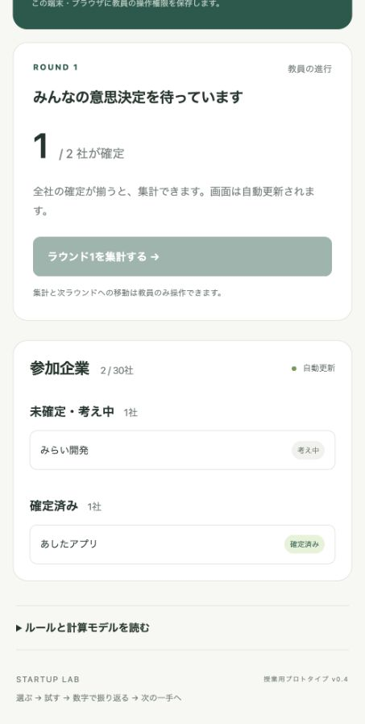

# v0.4 動作確認記録

2026年10月25日（日本時間）、Node.js v24.19.0。

## 自動テスト

`node --test`：35件すべて成功。

- 基礎モデルv0.3とW1の全6,363選択の魅力度・収入一致、2／20／30社×各100試行の配分・損益一致。
- v0.4の初回がv0.3と同じであること、市場別資源の蓄積・80%残存・小さな顧客配分差・未経験市場への非移転。
- 過去の広告のみを変えても次回結果が同じであること。
- 移行費用の比例計算と、固定費・利益・分岐点への一度だけの計上。
- 30社・3ラウンドのAPI進行、履歴を使う資源継続、再起動復元、二重操作防止・権限・秘密保持。
- 3桁コードの発行・重複回避・満杯時の終了。
- 旧版v0.2・v0.3ゲームの計算方式維持。
- admin.htmlとプレイヤーHTMLの分離、プレイヤー用HTMLにルール本文がないこと。
- プレイヤーAPIに資源値・生産性係数・顧客タイプ内訳を含めず、運営管理者APIには必要な値を維持。

## ブラウザ

ゲーム運営管理者用admin.htmlで作成→3桁コード129発行→student.htmlから2社登録→1社確定・1社未確定の表示を確認。未確定者がいる間は集計ボタンが無効で、「未確定・考え中」と「確定済み」の会社名・人数が分かれて表示されます。

プレイヤー入口・意思決定画面にルール本文・リンクや運営管理者の作成欄がないこと、開発経験と広告の説明、移行費用を含む固定費表示を確認しました。

## 追加シミュレーション

2／20／30社×各1,000ゲーム×3回を旧新版の同じランダム意思決定で比較。顧客数変化はこの試行で最大約5.4%。移行費用により頻繁な市場変更には費用が増えることを確認。詳しくはRESOURCES-v0.4.mdおよびbalance/results/resources-v4.json。

実際のプレイヤーの行動、授業効果、全条件での最大変化幅を保証するものではありません。30台の実機・学校Wi-Fi・クラウド配置は未検証です。

## 配置

静的配信用ビルド成功。admin.html、student.html、teacher/index.html（運営管理者用）、play/index.html（プレイヤー用）の出力と対応を確認。ZIPには保存データ・操作権限を含めません。
